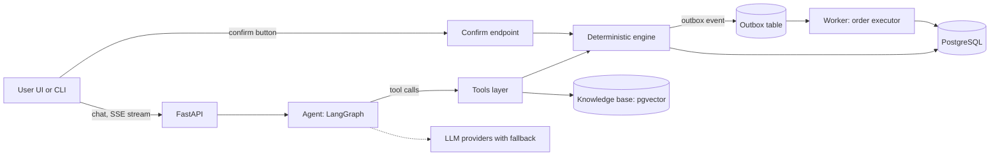

# Mizan

> **Educational simulation.** Mizan uses fictional funds and synthetic prices, holds no real
> money, and does not give investment advice.

Mizan is a consent-first investing assistant agent for a simulated brokerage account.
A user asks questions, understands their portfolio, and asks for a plan. The agent reads the
portfolio, computes the gap to a target allocation, and prepares **draft** buy and sell orders.
**Only the user can confirm an order.**

## Design principles

1. **The LLM explains and suggests. Code computes and executes.** Every number a user sees comes
   from a deterministic engine, never from the model.
2. **The agent cannot confirm.** The agent has no confirm tool. Confirmation is a separate
   endpoint called by a user action with a one time token. See
   [ADR 0002](docs/adr/0002-agent-cannot-confirm-orders.md).
3. **PostgreSQL is the single source of truth.** Orders and events are written in one
   transaction (outbox pattern), so nothing is lost or executed twice.
4. **Everything is measured.** Runs are traced, failures are categorised, and evals check the
   resulting state, not only the reply text.

## Status

Phases 0 and 1 are done: foundation, CI, and the deterministic engine (target allocation, gap,
drift, and order planning, see [ADR 0006](docs/adr/0006-allocation-rules-and-order-planning.md)).
The backend, agent, and evals
follow in later phases.

| Phase | Scope |
|---|---|
| 0 | Repository, tooling, CI, first ADRs, synthetic data |
| 1 | Deterministic engine: allocation, gap, drift, order planning |
| 2 | FastAPI, PostgreSQL, outbox, worker, idempotency, reconciliation |
| 3 | LangGraph agent, tools, routing, guardrails, confirmation flow, RAG, streaming |
| 4 | Observability and evals |
| 5 | Operations and cost |

## Architecture



## Development

Requires Python 3.12.

```powershell
python -m venv .venv
.venv\Scripts\python -m pip install -e ".[dev]"
.venv\Scripts\python -m ruff check .
.venv\Scripts\python -m ruff format --check .
.venv\Scripts\python -m mypy
.venv\Scripts\python -m pytest
```

Tests never call a real LLM provider. They use `FakeLLM`. Database tests run when `DATABASE_URL`
points at PostgreSQL with the pgvector extension, which CI provides as a service container.
Copy `.env.example` to `.env` for local settings. Never commit `.env`.

## Project rules

Architecture decisions live in [docs/adr](docs/adr). Fund names, prices, and data are fictional
and written for this project.

## License

MIT. See [LICENSE](LICENSE).
