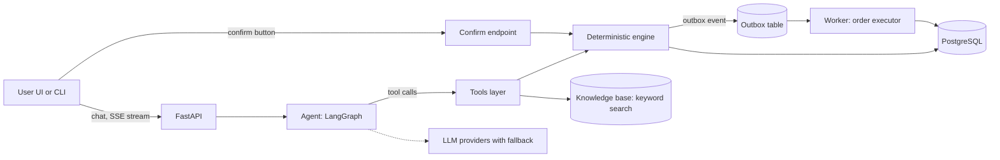

# Mizan

> **Educational simulation.** Mizan uses fictional funds and synthetic prices, holds no real
> money, and does not give investment advice.

Mizan is a consent-first investing assistant agent for a simulated brokerage account.
A user asks questions, understands their portfolio, and asks for a plan. The agent reads the
portfolio, computes the gap to a target allocation, and prepares **draft** buy and sell orders.
**Only the user can confirm an order.**

## Design principles

1. **The LLM explains and suggests. Code computes and executes.** Every number a user sees comes
   from a deterministic engine, never from the model.
2. **The agent cannot confirm.** The agent has no confirm tool. Confirmation is a separate
   endpoint called by a user action with a one time token. See
   [ADR 0002](docs/adr/0002-agent-cannot-confirm-orders.md).
3. **PostgreSQL is the single source of truth.** Orders and events are written in one
   transaction (outbox pattern), so nothing is lost or executed twice.
4. **Everything is measured.** Runs are traced, failures are categorised, and evals check the
   resulting state, not only the reply text.

## Status

Phases 0 to 4 are built. The LLM judge with human labels (the last part of phase 4) is still
pending, and phase 5 (operations and cost) is next.

Done so far: the deterministic engine, the backend with confirmation, outbox worker, ledger and
reconciliation, the agent with six tools and guardrails, run tracing, and a golden set of 37
scenarios that checks resulting state. The first live results and their failure analysis are in
[docs/evals/report-1.md](docs/evals/report-1.md). A captured walkthrough of the confirmation flow is
in [docs/demo.md](docs/demo.md).

| Phase | Scope | State |
|---|---|---|
| 0 | Repository, tooling, CI, first ADRs, synthetic data | Done |
| 1 | Deterministic engine: allocation, gap, drift, order planning | Done |
| 2 | FastAPI, PostgreSQL, outbox, worker, idempotency, reconciliation | Done |
| 3 | LangGraph agent, tools, routing, guardrails, confirmation flow, streaming | Done (knowledge search is keyword based, vector search is not built yet) |
| 4 | Tracing and evals | Built, LLM judge with human labels pending |
| 5 | Operations and cost | Next |
| 6 | Optional model experiments | Not started |
| 7 | Case study write up | Not started |

## Try it in 2 minutes

You need Python 3.12 and a PostgreSQL server you can reach (version 14 or newer, the pgvector
extension is not needed for this). The `curl` commands assume a POSIX shell (Git Bash on Windows works).

```bash
python -m venv .venv
.venv/Scripts/python -m pip install -e ".[dev]"   # on Linux or macOS use .venv/bin/python
createdb mizan_demo
export DATABASE_URL=postgresql://YOUR_USER@localhost:5432/mizan_demo
```

Run the 37 evaluation scenarios with a scripted model (free, no API key):

```bash
.venv/Scripts/python -m mizan.evals --mode fake
```

Watch the whole flow, including a prompt injection that asks the agent to confirm (output is
captured in [docs/demo.md](docs/demo.md)):

```bash
.venv/Scripts/python -m mizan.demo
```

Start the API and walk through draft and confirm yourself:

```bash
eval "$(.venv/Scripts/python -m mizan.seed | sed 's/^/export /')"   # creates a demo account
.venv/Scripts/python -m uvicorn mizan.server:app --port 8000 &
until curl -s localhost:8000/health > /dev/null; do sleep 1; done   # wait for the server
H="X-User-Id: $USER_ID"; J="Content-Type: application/json"
DRAFT=$(curl -s -X POST localhost:8000/accounts/$ACCOUNT_ID/drafts -H "$H" -H "$J" -d '{"mode":"cash_flow"}')
DRAFT_ID=$(echo "$DRAFT" | .venv/Scripts/python -c "import sys,json; print(json.load(sys.stdin)['draft_id'])")
TOKEN=$(echo "$DRAFT" | .venv/Scripts/python -c "import sys,json; print(json.load(sys.stdin)['token'])")
C=localhost:8000/accounts/$ACCOUNT_ID/drafts/$DRAFT_ID/confirm

curl -s -X POST $C -H "$H" -H "$J" -d "{\"token\":\"$TOKEN\"}"                          # 400 idempotency_key_required
curl -s -X POST $C -H "$H" -H "$J" -H "Idempotency-Key: k1" -d '{"token":"wrong"}'      # 403 invalid_token
curl -s -X POST $C -H "$H" -H "$J" -H "Idempotency-Key: k1" -d "{\"token\":\"$TOKEN\"}"  # 200, order confirmed
curl -s localhost:8000/accounts/$ACCOUNT_ID/portfolio -H "$H"                          # cash is still 1000.00
.venv/Scripts/python -m mizan.run_worker                                               # the worker executes it
curl -s localhost:8000/accounts/$ACCOUNT_ID/portfolio -H "$H"                          # cash is now 12.50
```

Confirming only records the order. Money moves when the separate worker runs. The chat endpoint
(`POST /accounts/{id}/chat`) needs `GEMINI_API_KEY` in your environment and answers 503 without it.
The agent can only prepare drafts: it has no tool that confirms, so a prompt injection cannot make
it confirm (see [docs/demo.md](docs/demo.md) and [ADR 0002](docs/adr/0002-agent-cannot-confirm-orders.md)).
This API trusts the `X-User-Id` header, which is fine for a local simulation and is not real
authentication.

## Architecture



## Development

Requires Python 3.12.

```powershell
python -m venv .venv
.venv\Scripts\python -m pip install -e ".[dev]"
.venv\Scripts\python -m ruff check .
.venv\Scripts\python -m ruff format --check .
.venv\Scripts\python -m mypy
.venv\Scripts\python -m pytest
```

Set `DATABASE_URL` to run the database tests (they are skipped without it).
Tests never call a real LLM provider. They use `FakeLLM`. Database tests run when `DATABASE_URL`
points at PostgreSQL with the pgvector extension, which CI provides as a service container.
Copy `.env.example` to `.env` for local settings. Never commit `.env`.

## Project rules

Architecture decisions live in [docs/adr](docs/adr). Fund names, prices, and data are fictional
and written for this project.

## License

MIT. See [LICENSE](LICENSE).
